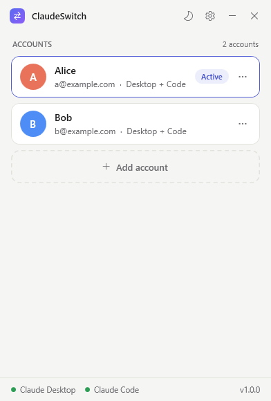
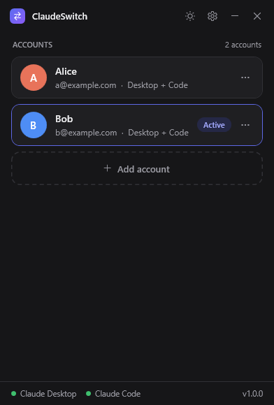
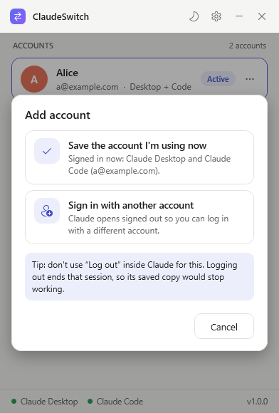

<p align="center"></p>

<h1 align="center">ClaudeSwitch</h1>

<p align="center">
A small, open-source account switcher for Claude on Windows.<br>
Add your Claude accounts once, then switch between them with one click.
</p>

<p align="center">

&nbsp;

</p>

> **Unofficial.** ClaudeSwitch is a community tool. It is not made by, endorsed by, or affiliated with Anthropic.

## Features

- **One-click switching** between Claude accounts, the same idea as a Steam account switcher.
- Switches **Claude Desktop** (the Windows app) and **Claude Code** (the CLI). Either one or both.
- **Light and dark mode**: follows Windows, or pick one yourself (sun/moon button or Settings).
- **Small**: one ~250 KB `.exe`, nothing to install, no admin rights.
- **Safe by design**: before anything is replaced, the current sign-in is copied somewhere safe first
  (into its saved account, so refreshed tokens are kept, or into a backup folder).
- **Private**: everything stays on your PC. Claude Code tokens are encrypted with your Windows account (DPAPI).
  ClaudeSwitch never connects to the internet.

## How to use

1. Open **ClaudeSwitch.exe**.
2. Click **Add account**:
   - **Save the account I'm using now**: saves whatever Claude is signed in to right now.
   - **Sign in with another account**: ClaudeSwitch keeps your current sign-in safe, then opens Claude signed out.
     Sign in with the other account, come back, and click **Save account**.
3. Repeat for every account you have.
4. **Click an account to switch to it.** Claude Desktop closes and reopens, signed in as that account.

<p align="center"></p>

Each account has a **⋯** menu with **Rename**, **Update saved sign-in** and **Remove**.

### Two important tips

- **Don't use "Log out" inside Claude** to change accounts. Logging out ends that session on Anthropic's side,
  so its saved copy would stop working. Use **Add account → Sign in with another account** instead.
- After switching, **restart any open Claude Code sessions** (terminal windows running `claude`),
  because a running session keeps the account it started with.

## Download

Get **ClaudeSwitch.exe** from the [latest release](https://github.com/Bader-foren/ClaudeSwitch/releases/latest)
and double-click it. There is nothing to install.

Windows may show "Windows protected your PC" the first time, because the app isn't code-signed.
Click **More info → Run anyway**. You can also build it yourself from this source code (below).

## Build it yourself

No Visual Studio or .NET SDK needed. Windows 10 and 11 already include everything:

```bat
git clone https://github.com/Bader-foren/ClaudeSwitch.git
cd ClaudeSwitch
build.cmd
```

The app is written to `bin\ClaudeSwitch.exe`. It uses the C# compiler that ships with Windows
(.NET Framework 4.8) and WPF.

Run the engine self-test (it only uses fake Claude folders and never touches your real Claude):

```bat
build.cmd test
```

## How it works

Claude has no built-in account switching, so ClaudeSwitch swaps the files that hold the sign-in.

**Claude Desktop** (found automatically in `%LOCALAPPDATA%\Claude-Data\…`, the Microsoft Store package folder,
or `%APPDATA%\Claude`):

| Swapped per account | Why |
| --- | --- |
| `Network\Cookies` | the claude.ai session |
| `Local State` | the key the cookies are encrypted with |
| `Local Storage`, `Session Storage`, `IndexedDB`, `WebStorage` | the web app's data for that account |
| `oauth:*` and `lastKnownAccountUuid` inside `config.json` | account tokens (all other settings, like language, are left alone) |

Everything else (MCP servers in `claude_desktop_config.json`, caches, extensions, your Claude Code sessions)
is never touched. Claude Desktop has to be closed while the files are swapped, because it locks them.
ClaudeSwitch only closes the Desktop app, never `claude` CLI processes.

**Claude Code**: `~/.claude/.credentials.json` and the `oauthAccount` entry in `~/.claude.json`
(or both under `CLAUDE_CONFIG_DIR` if you set it). Only that one entry of `.claude.json` is edited;
the rest of the file stays byte-for-byte the same.

**Switching** from account A to account B:

1. Close Claude Desktop.
2. Copy A's live sign-in into A's saved copy (so tokens that refreshed while you used A are kept).
   If the live sign-in doesn't belong to any saved account, it goes into a backup folder instead.
3. Put B's saved sign-in in place.
4. Open Claude Desktop again.

## Your data

Saved accounts, settings, backups and a small log live in `%APPDATA%\ClaudeSwitch`
(Settings → **Open data folder**). The last 12 backups are kept.

**Portable mode:** put an empty file named `portable.txt` next to `ClaudeSwitch.exe`, and data is kept in a
`data` folder next to the exe instead.

Treat the data folder like a password: it holds working sign-ins for your accounts. Claude Desktop's cookies are
encrypted by Windows for your user account, and Claude Code tokens are encrypted by ClaudeSwitch the same way,
so the copies only work for your Windows user on this PC.

## Advanced

`settings.json` in the data folder can be edited while ClaudeSwitch is closed:

- `DesktopDataDir`: force a Claude Desktop data folder (also in Settings → Change…).
- `DesktopItems`: the list of Claude Desktop files/folders to swap, if a future Claude version moves its sign-in.
- `ReopenDesktop`: whether to open Claude Desktop after switching.

For development and tests, these environment variables point ClaudeSwitch at other folders:
`CLAUDESWITCH_DATA`, `CLAUDESWITCH_DESKTOP_DIR`, `CLAUDESWITCH_CODE_DIR`, `CLAUDESWITCH_CODE_CONFIG`.
`CLAUDESWITCH_NO_PROCESS=1` stops it from closing or opening Claude Desktop.

## Project layout

```
src/Core/     switching engine (no UI): Claude Desktop, Claude Code, storage, JSON editing
src/App/      the WPF window: MainWindow.xaml, MainWindow.cs, Theme.cs, Program.cs
tests/        engine self-test (build.cmd test)
tools/        make-icon.ps1 (draws assets/icon.ico)
```

## Limitations

- Windows only (Claude Code on macOS keeps its sign-in in the Keychain, which this version doesn't handle).
- Claude may change where it stores the sign-in in a future update. If switching stops working,
  please open an issue. The file list can be changed in `settings.json` without a new build.

## License

[MIT](LICENSE). "Claude" is a trademark of Anthropic. This project is not affiliated with Anthropic.
